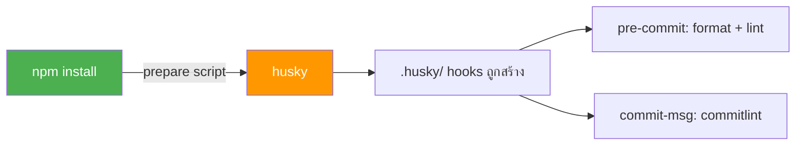

# Coding Guidelines — rat Services

> กฎและ best practices สำหรับทีม, enforce ด้วย ESLint + Prettier + Husky

## สารบัญ

### ESLint Rules

| #   | Rule                                                                                                                   | Level    |
| --- | ---------------------------------------------------------------------------------------------------------------------- | -------- |
| 1   | [No Unused Variables](#1-no-unused-variables--typescript-eslintno-unused-vars-error)                                   | ❌ error |
| 2   | [No Explicit `any`](#2-no-explicit-any--typescript-eslintno-explicit-any-error)                                        | ❌ error |
| 3   | [~~Explicit Return Types~~](#3-explicit-return-types--typescript-eslintexplicit-function-return-type-off)              | 🚫 off   |
| 4   | [~~Explicit Module Boundary~~](#4-explicit-module-boundary-types--typescript-eslintexplicit-module-boundary-types-off) | 🚫 off   |
| 5   | [Naming Conventions](#5-naming-conventions--typescript-eslintnaming-convention-error)                                  | ❌ error |
| 6   | [No Duplicate Imports](#6-no-duplicate-imports--no-duplicate-imports-error)                                            | ❌ error |
| 7   | [No Console](#7-no-console-️-no-console-warn)                                                                           | ⚠️ warn  |
| 8   | [Max Lines Per Function](#8-max-lines-per-function-️-max-lines-per-function-150)                                        | ⚠️ warn  |
| 9   | [Complexity Limit](#9-complexity-limit-️-complexity-15)                                                                 | ⚠️ warn  |
| 10  | [No Floating Promises](#10-no-floating-promises-️-typescript-eslintno-floating-promises-warn)                           | ⚠️ warn  |

### Architecture & Convention

| #   | Topic                                                                |
| --- | -------------------------------------------------------------------- |
| 11  | [Layer Pattern Rules](#11-layer-pattern-rules-️)                      |
| 12  | [Import Convention](#12-import-convention-)                          |
| 13  | [Prettier Formatting](#13-prettier-formatting-)                      |
| 14  | [Commit Convention](#14-commit-convention--commitlint)               |
| 15  | [Git Hooks (Husky)](#15-git-hooks-husky-v9-)                         |
| 16  | [API Response (Unified)](#16-api-response-ต้อง-unified--convention)  |
| 17  | [Auth Guard](#17-auth-guard-ทุก-controller--convention)              |
| 18  | [Error Handling](#18-error-handling--manager-ต้อง-catch--convention) |
| 19  | [VS Code Setup](#19-vs-code-setup-️)                                  |
| 20  | [Boolean Naming Convention](#20-boolean-naming-convention-)          |

---

## 1. No Unused Variables ❌ `@typescript-eslint/no-unused-vars: error`

```typescript
// ❌ BAD — ประกาศแล้วไม่ใช้
const result = await this.service.getData();
const unused = 'hello';
return result;

// ✅ GOOD — ลบตัวที่ไม่ใช้ออก
const result = await this.service.getData();
return result;

// ✅ GOOD — ถ้าจงใจไม่ใช้ ให้ขึ้นต้นด้วย _
async handleEvent(_payload: MessageContextDto, data: EventDto): Promise<void> {
  await this.service.process(data);
}
```

---

## 2. No Explicit `any` ❌ `@typescript-eslint/no-explicit-any: error`

```typescript
// ❌ BAD — any ทำให้ไม่มี type safety
async processData(data: any): Promise<any> {
  return data.someField;
}

// ✅ GOOD — ใช้ type/interface ชัดเจน
async processData(data: CreateExampleDto): Promise<ExampleEntity> {
  return this.repository.create(data);
}

// ✅ GOOD — ถ้ายังไม่รู้ type ใช้ unknown แทน
async handleUnknown(data: unknown): Promise<void> {
  if (isExampleDto(data)) {
    await this.processData(data);
  }
}
```

---

## 3. ~~Explicit Return Types~~ 🚫 `@typescript-eslint/explicit-function-return-type: off`

> ปิดไว้ — ไม่บังคับ return type (TypeScript infer ได้เอง)

```typescript
// ทั้ง 2 แบบ OK
async getExample(id: string) {
  return this.repository.findById(id);
}

// แนะนำใส่ในจุดสำคัญ แต่ไม่ error
async getExample(id: string): Promise<ExampleEntity> {
  return this.repository.findById(id);
}
```

---

## 4. ~~Explicit Module Boundary Types~~ 🚫 `@typescript-eslint/explicit-module-boundary-types: off`

> ปิดไว้ — ไม่บังคับ type บน public methods

```typescript
// ทั้ง 2 แบบ OK
export class ExampleService {
  getData() {
    return [1, 2, 3];
  }
}

// แนะนำใส่ใน public API แต่ไม่ error
export class ExampleService {
  getData(): number[] {
    return [1, 2, 3];
  }
}
```

---

## 5. Naming Conventions ❌ `@typescript-eslint/naming-convention: error`

> **Interface / Enum / Type ต้องมี prefix** — ESLint จะ error ทันทีถ้าไม่มี

```typescript
// ❌ BAD — ไม่มี prefix
export interface OrderEntity {}
export enum OrderStatus {
  PENDING,
  COMPLETED,
}
export type OrderDocument = HydratedDocument<Order>;

// ✅ GOOD — I / E / T prefix
export interface IOrderEntity {}
export enum EOrderStatus {
  PENDING,
  COMPLETED,
}
export type TOrderDocument = HydratedDocument<Order>;

// ❌ BAD — ชื่อ class ไม่ใช่ PascalCase
export class example_service {}

// ✅ GOOD — class ไม่ต้องใส่ prefix
export class ExampleService {}
```

| Type            | Format                       | Prefix             | Example                                         |
| --------------- | ---------------------------- | ------------------ | ----------------------------------------------- |
| **interface**   | `PascalCase`                 | **`I` (required)** | `IOrderEntity`, `IQueryOptions`, `IEsbResponse` |
| **enum**        | `PascalCase`                 | **`E` (required)** | `EOrderStatus`, `EChannel`, `EResultCode`       |
| **type**        | `PascalCase`                 | **`T` (required)** | `TOrderDocument`, `TResultCode`, `TApiConfig`   |
| **class**       | `PascalCase`                 | —                  | `OrderService`, `BaseCacheService`              |
| **enum member** | `UPPER_CASE` or `PascalCase` | —                  | `ACTIVE`, `NotFound`                            |

---

## 6. No Duplicate Imports ❌ `no-duplicate-imports: error`

```typescript
// ❌ BAD — import จาก module เดียวกัน 2 ครั้ง
import { ConfigService } from '@corpais/rat-common-lib';
import { CustomLoggerService } from '@corpais/rat-common-lib';

// ✅ GOOD — รวม import จาก module เดียวกัน
import { ConfigService, CustomLoggerService } from '@corpais/rat-common-lib';
```

---

## 7. No Console ⚠️ `no-console: warn`

```typescript
// ❌ BAD — console.log หลุดไป production
console.log('Debugging data:', data);
console.error('Error:', error);

// ✅ GOOD — ใช้ CustomLoggerService
this.logger.info(LoggerAction.PROCESSING('Processing data'), data);
this.logger.error(LoggerAction.FAILED('Operation failed'), error);
```

---

## 8. Max Lines Per Function ⚠️ `max-lines-per-function: 150`

```typescript
// ❌ BAD — function ยาวเกิน 150 บรรทัด
async handleComplexFlow(data: DataDto): Promise<void> {
  // ... 200+ lines of logic ...
}

// ✅ GOOD — แยกเป็น private methods
async handleComplexFlow(data: DataDto): Promise<void> {
  const validated = this.validateInput(data);
  const transformed = this.transformData(validated);
  const result = await this.persistData(transformed);
  await this.notifyDownstream(result);
}

private validateInput(data: DataDto): ValidatedData {
  // validation logic (20 lines)
}

private transformData(data: ValidatedData): TransformedData {
  // transform logic (30 lines)
}

private async persistData(data: TransformedData): Promise<PersistedData> {
  // persist logic (20 lines)
}

private async notifyDownstream(data: PersistedData): Promise<void> {
  // notification logic (15 lines)
}
```

---

## 9. Complexity Limit ⚠️ `complexity: 15`

```typescript
// ❌ BAD — if/else ซ้อนกันเยอะเกินไป (cyclomatic complexity > 15)
async processOrder(order: Order): Promise<void> {
  if (order.type === 'A') {
    if (order.status === 'pending') {
      if (order.amount > 1000) {
        if (order.priority === 'high') {
          // ... deep nesting
        }
      }
    }
  }
}

// ✅ GOOD — ใช้ early return + strategy pattern
async processOrder(order: Order): Promise<void> {
  if (!this.isValidOrder(order)) return;

  const strategy = this.getProcessingStrategy(order.type);
  await strategy.process(order);
}

private isValidOrder(order: Order): boolean {
  return order.status === 'pending' && order.amount > 0;
}

private getProcessingStrategy(type: string): OrderStrategy {
  const strategies: Record<string, OrderStrategy> = {
    A: new TypeAStrategy(),
    B: new TypeBStrategy(),
  };
  return strategies[type] ?? new DefaultStrategy();
}
```

---

## 10. No Floating Promises ⚠️ `@typescript-eslint/no-floating-promises: warn`

```typescript
// ❌ BAD — promise ไม่ได้ await จะไม่ catch error ได้
this.producer.publish(data, topic);
this.repository.update(id, data);

// ✅ GOOD — await ทุก promise
await this.producer.publish(data, topic);
await this.repository.update(id, data);

// ✅ GOOD — ถ้า fire-and-forget จงใจ ให้ใช้ void
void this.sendNotification(data);
```

---

## 11. Layer Pattern Rules 🏗️

### Controller → ห้ามมี business logic

```typescript
// ❌ BAD — business logic อยู่ใน controller
@HttpEntryPoint('createExample')
@Post()
async create(@Req() req: Request, @Res() res: Response): Promise<void> {
  const data = req.body;
  const validated = await validate(data);     // ❌ business logic
  const saved = await this.repo.create(data); // ❌ direct repo call
  res.status(200).json(saved);
}

// ✅ GOOD — delegate ไป manager
@HttpEntryPoint('createExample')
@Post()
async create(@Req() req: Request, @Res() res: Response): Promise<void> {
  await this.manager.handleCreateExample(req, res);
}
```

### Manager → orchestrate + try/catch + flush + unified response

> **ไม่ต้อง log INBOUND/OUTBOUND เอง** — `CustomRestInterceptor` จัดการให้อัตโนมัติ

```typescript
import { FlushSummaryLog, buildSuccessResponse, buildErrorResponse, buildResultCode, ResultCodes } from '@corpais/rat-common-lib';

// ❌ BAD — ไม่มี try/catch, ไม่ flush, response ไม่ unified
async handleCreate(req: Request, res: Response): Promise<void> {
  const result = await this.service.create(req.body);
  res.status(200).json(result);
}

// ✅ GOOD — try/catch + unified response + flush
async handleCreate(req: Request, res: Response): Promise<void> {
  try {
    const result = await this.service.create(req.body);
    res.status(HttpStatus.CREATED).json(
      buildSuccessResponse(result, ResultCodes.CREATED),  // ← (data, code?) — data first
    );
    this.summaryFlush.flush();                    // ← structured log (สำเร็จ)
  } catch (error) {
    this.summaryFlush.flushError(error);          // ← structured log (error)
    this.sendErrorResponse(res, error);           // ← unified error to client
  }
}

// ✅ GOOD — reusable error helper (ใช้ buildResultCode map HTTP → result code)
private sendErrorResponse(response: Response, error: unknown): void {
  const status = error instanceof HttpException
    ? error.getStatus()
    : HttpStatus.INTERNAL_SERVER_ERROR;

  const message = error instanceof HttpException
    ? (error.getResponse() as Record<string, unknown>)?.message ?? error.message
    : error instanceof Error ? error.message : 'Unknown error';

  response.status(status).json(
    buildErrorResponse(buildResultCode(status), String(message), status),  // ← (resultCode, devMsg, httpStatus?)
  );
}
```

### Service → pure business logic, no HTTP concerns

```typescript
// ❌ BAD — Service รู้จัก Request/Response
async create(req: Request, res: Response): Promise<void> {
  res.status(200).json(await this.repo.create(req.body));
}

// ✅ GOOD — รับ/ส่ง data เฉยๆ
async create(data: CreateExampleDto): Promise<ExampleEntity> {
  return this.repository.create(data);
}
```

---

## 12. Import Convention 📦

```typescript
// ✅ GOOD — ลำดับ import ที่ถูกต้อง

// 1. NestJS core
import { Injectable, HttpStatus } from '@nestjs/common';

// 2. Shared library
import { ConfigService, CustomLoggerService, ResultCodes } from '@corpais/rat-common-lib';

// 3. Third-party
import { Request, Response } from 'express';

// 4. Local modules (relative)
import { ExampleService } from '../services/example.service';
import { CreateExampleDto } from '../dtos/request/create-example.dto';
```

---

## 13. Prettier Formatting 🎨

ทุกไฟล์บังคับใช้ `.prettierrc`:

| Rule            | Value  |
| --------------- | ------ |
| `singleQuote`   | `true` |
| `trailingComma` | `all`  |
| `printWidth`    | `100`  |
| `tabWidth`      | `2`    |
| `semi`          | `true` |
| `endOfLine`     | `lf`   |

```bash
# Format ทุกไฟล์
npm run format

# เช็คว่า format ถูกต้อง (CI)
npm run format:check
```

---

## 14. Commit Convention 📝 `commitlint`

ทุก commit message ต้องตาม [Conventional Commits](https://www.conventionalcommits.org/):

```
<type>(scope): <subject>
```

### Types ที่ใช้ได้

| Type       | ใช้เมื่อ                       | ตัวอย่าง                                |
| ---------- | ------------------------------ | --------------------------------------- |
| `feat`     | เพิ่ม feature ใหม่             | `feat(example): add create endpoint`    |
| `fix`      | แก้ bug                        | `fix(kafka): handle null payload`       |
| `docs`     | เปลี่ยน docs                   | `docs: update README`                   |
| `style`    | Format code (ไม่เปลี่ยน logic) | `style: fix prettier warnings`          |
| `refactor` | Refactor code                  | `refactor(service): extract validation` |
| `perf`     | ปรับ performance               | `perf(repo): add DB index`              |
| `test`     | เพิ่ม/แก้ test                 | `test(example): add unit tests`         |
| `build`    | Build system                   | `build: update tsconfig`                |
| `ci`       | CI/CD                          | `ci: add lint step`                     |
| `chore`    | งาน maintenance                | `chore: bump dependencies`              |
| `revert`   | Revert commit                  | `revert: revert feat(example)`          |

### ตัวอย่าง

```bash
# ✅ GOOD
git commit -m "feat(notification): add WebSocket broadcast"
git commit -m "fix(redis-cache): handle connection timeout"
git commit -m "docs: update architecture diagram"

# ❌ BAD — commitlint จะ reject
git commit -m "update code"           # ไม่มี type
git commit -m "FEAT: add feature"     # type ต้อง lowercase
git commit -m "feat: "                # ไม่มี subject
```

### Rules

| Rule                   | ค่า        | ความหมาย                      |
| ---------------------- | ---------- | ----------------------------- |
| `type-enum`            | error      | ต้องเป็น 1 ใน 11 types ด้านบน |
| `subject-max-length`   | error, 100 | หัวข้อยาวไม่เกิน 100 ตัวอักษร |
| `body-max-line-length` | warn, 200  | Body แต่ละบรรทัดไม่เกิน 200   |

---

## 15. Git Hooks (Husky v9) 🪝

### ใครต้องติดตั้ง?

> **ทุกคนที่ `npm install` จะได้ hooks อัตโนมัติ** — ไม่ต้องทำอะไรเพิ่ม



### Flow ของ Lead (ตั้งค่าครั้งเดียว)

```bash
# 1. ติดตั้ง dependencies
npm install husky @commitlint/cli @commitlint/config-conventional --save-dev

# 2. เปิดใช้ Husky (สร้าง .husky/)
npx husky init

# 3. สร้าง pre-commit hook
echo "npm run format && npm run lint" > .husky/pre-commit

# 4. สร้าง commit-msg hook
echo "npx --no -- commitlint --edit \$1" > .husky/commit-msg

# 5. ตรวจ package.json มี prepare script
# "prepare": "husky"  ← ต้องมี!

# 6. Commit & Push — จบ!
git add .husky/ commitlint.config.js package.json
git commit -m "chore: setup husky + commitlint"
git push
```

### Flow ของ Dev ทุกคน (ไม่ต้องทำอะไรเลย)

```bash
# แค่ clone + install
git clone <repo-url>
npm install          # ← "prepare": "husky" จะรันอัตโนมัติ
                     #    hooks พร้อมใช้ทันที ✅

# ลอง commit
git commit -m "feat(example): add new endpoint"  # ✅ ผ่าน
git commit -m "update code"                       # ❌ commitlint reject
```

### สรุป

```
                     npm install
                         │
                         ▼
               "prepare": "husky"
                         │
                         ▼
              .husky/ hooks พร้อมใช้
                    ╱          ╲
                   ▼            ▼
           pre-commit        commit-msg
           ┌─────────┐      ┌──────────┐
           │ format   │      │commitlint│
           │ lint     │      │          │
           └─────────┘      └──────────┘
           ไม่ผ่าน → ❌      ไม่ผ่าน → ❌
           reject commit     reject commit
```

---

## 16. API Response ต้อง Unified ❌ `convention`

```typescript
import { buildSuccessResponse, buildErrorResponse, ResultCodes } from '@corpais/rat-common-lib';

// ❌ BAD — response format ไม่เป็นมาตรฐาน
res.json({ success: true, data: result });
res.json({ error: 'Not found' });

// ✅ GOOD — ใช้ helper function ทุกครั้ง (signature ดูล่าง)
res.json(buildSuccessResponse(result));
res.status(404).json(buildErrorResponse(ResultCodes.NOT_FOUND, 'Order not found', 404));
```

### Helper Signatures

| Helper                 | Signature                                                            |
| ---------------------- | -------------------------------------------------------------------- |
| `buildSuccessResponse` | `(data, code? = '20000')` — data ก่อน, default code `20000`          |
| `buildErrorResponse`   | `(resultCode, developerMessage, httpStatus?, messageList?)`          |
| `buildResultCode`      | `(httpStatus) → TResultCode` — เช่น `200 → '20000'`, `404 → '40400'` |

### Response Format

```json
// Success
{
  "resultCode": "20000",
  "resultDescription": "Success",
  "developerMessage": "",
  "data": { ... }
}

// Error
{
  "resultCode": "40400",
  "resultDescription": "Resource not found",
  "developerMessage": "Order not found",
  "data": { "message": "ไม่พบข้อมูลที่ร้องขอ", "messageList": [] }
}
```

---

## 17. Auth Guard ทุก Controller ❌ `convention`

```typescript
import { UseGuards } from '@nestjs/common';
import { AuthGuard, CustomRestInterceptor } from '@corpais/rat-common-lib';

// ❌ BAD — ไม่มี guard = ใครก็เข้าได้
@Controller('orders')
export class OrderController { ... }

// ✅ GOOD — guard + interceptor ครบ
@Controller('orders')
@UseGuards(AuthGuard)                       // ← validate x-authorization
@UseInterceptors(CustomRestInterceptor)      // ← init logger context
export class OrderController { ... }
```

Config token ที่ `local.config.yaml`:

```yaml
app:
  auth-token: 'local-dev-token'
```

---

## 18. Error Handling — Manager ต้อง catch ❌ `convention`

```typescript
// ❌ BAD — throw แล้วไม่ catch → ไม่ได้ structured log
async handleGetOrders(req: Request, res: Response) {
  const result = await this.service.getOrders();
  res.json(result);    // ถ้า service throw → AllExceptionsFilter จัดการแต่ไม่ได้ log
}

// ✅ GOOD — catch → flushError (structured log) + unified error response
async handleGetOrders(req: Request, res: Response) {
  try {
    const result = await this.service.getOrders();
    res.json(buildSuccessResponse(result));
    this.summaryFlush.flush();
  } catch (error) {
    this.summaryFlush.flushError(error);          // ← log with session context
    this.sendErrorResponse(res, error);           // ← unified JSON to client
  }
}
```

### Error Flow

```
Guard rejection (no token)  → AllExceptionsFilter → unified 401
Manager catch               → flushError + sendErrorResponse
Service throws              → propagates to Manager catch
```

> `AllExceptionsFilter` เป็นแค่ safety net — structured logging ต้องทำใน Manager catch block

---

## Quick Reference — All Rules

| Rule                             | Level         | Key Message                                                                    |
| -------------------------------- | ------------- | ------------------------------------------------------------------------------ |
| `no-unused-vars`                 | ❌ error      | ลบ dead code ออก, ใช้ `_` prefix ถ้าจงใจ                                       |
| `no-explicit-any`                | ❌ error      | ใช้ type/interface แทน `any`                                                   |
| `explicit-function-return-type`  | 🚫 off        | ปิดไว้ (แนะนำใส่แต่ไม่บังคับ)                                                  |
| `explicit-module-boundary-types` | 🚫 off        | ปิดไว้ (แนะนำใส่แต่ไม่บังคับ)                                                  |
| `naming-convention`              | ❌ error      | **I** prefix interface, **E** prefix enum, **T** prefix type, PascalCase class |
| `no-duplicate-imports`           | ❌ error      | รวม import จาก module เดียวกัน                                                 |
| `no-console`                     | ⚠️ warn       | ใช้ `CustomLoggerService` แทน                                                  |
| `max-lines-per-function`         | ⚠️ warn       | ≤ 150 บรรทัด/function (ไม่นับ blank+comment)                                   |
| `complexity`                     | ⚠️ warn       | ≤ 15 cyclomatic complexity                                                     |
| `no-floating-promises`           | ⚠️ warn       | `await` ทุก promise หรือ `void` ถ้าจงใจ                                        |
| `commitlint type-enum`           | ❌ error      | feat/fix/docs/style/refactor/perf/test/build/ci/chore/revert                   |
| `commitlint subject-max-length`  | ❌ error      | ≤ 100 ตัวอักษร                                                                 |
| Unified API response             | ❌ convention | ใช้ `buildSuccessResponse`/`buildErrorResponse` ทุกครั้ง                       |
| Auth Guard                       | ❌ convention | `@UseGuards(AuthGuard)` ทุก controller                                         |
| Manager catch                    | ❌ convention | `try/catch` + `flushError` + `sendErrorResponse`                               |

---

## 19. VS Code Setup 🛠️

### Required Extensions

เปิด project → VS Code จะแนะนำให้ลง → กด **Install All**

| Extension              | ID                                      | ทำอะไร                            |
| ---------------------- | --------------------------------------- | --------------------------------- |
| **Prettier**           | `esbenp.prettier-vscode`                | Auto format on save               |
| **ESLint**             | `dbaeumer.vscode-eslint`                | แสดง lint error/warning inline    |
| **Error Lens**         | `usernamehw.errorlens`                  | แสดง error ข้างบรรทัดเลย (ชัดมาก) |
| **Jest Runner**        | `firsttris.vscode-jest-runner`          | รัน/debug test จาก editor         |
| **Jest**               | `orta.vscode-jest`                      | Auto-run test + inline results    |
| **Code Spell Checker** | `streetsidesoftware.code-spell-checker` | ตรวจ typo ในชื่อตัวแปร/comment    |
| **TODO Tree**          | `gruntfuggly.todo-tree`                 | รวม TODO/FIXME ทั้ง project       |
| **GitLens**            | `eamodio.gitlens`                       | Git blame + history inline        |
| **DotENV**             | `mikestead.dotenv`                      | Syntax highlight ไฟล์ .env        |
| **YAML**               | `redhat.vscode-yaml`                    | Validate YAML config files        |

### Auto Format on Save

ตั้งค่าไว้ให้แล้วใน `.vscode/settings.json`:

```json
{
  "editor.formatOnSave": true,
  "editor.defaultFormatter": "esbenp.prettier-vscode",
  "editor.tabSize": 2,
  "editor.codeActionsOnSave": {
    "source.fixAll.eslint": "explicit"
  }
}
```

> กด **Cmd+S** (Save) → Prettier format + ESLint fix อัตโนมัติ

---

## 20. Boolean Naming Convention 🔤

> อ้างอิงจาก **Microsoft .NET Design Guidelines** และ best practices ของ software engineering

### Key Principle

Boolean ควรตั้งชื่อให้ **อ่านเหมือนประโยค (affirmative phrase)**

```typescript
if (user.isActive) {
}
if (order.hasPayment) {
}
if (user.canEdit) {
}
```

การตั้งชื่อแบบนี้ช่วยให้โค้ด อ่านง่าย ลด cognitive load และเข้าใจ business logic ได้เร็ว

### Recommended Prefix

| Prefix    | Usage                   | Example                        |
| --------- | ----------------------- | ------------------------------ |
| `is`      | state / status          | `isActive`, `isDeleted`        |
| `has`     | ownership / existence   | `hasPermission`, `hasChildren` |
| `can`     | capability / permission | `canEdit`, `canDelete`         |
| `should`  | business decision       | `shouldRetry`                  |
| `allow`   | policy / configuration  | `allowGuest`                   |
| `enabled` | feature toggle          | `isEnabled`, `featureEnabled`  |

### Example in Service

```typescript
@Injectable()
export class UserService {
  canEdit(user: User): boolean {
    return user.isAdmin || user.hasPermission;
  }
}
```

### Example in DTO

```typescript
export class CreateUserDto {
  isActive: boolean;
  allowGuest: boolean;
}
```

### Example in Entity

```typescript
@Entity()
export class User {
  @Column()
  isActive: boolean;

  @Column()
  isDeleted: boolean;
}
```

### Example in Controller

```typescript
@Get(':id')
async getUser(@Param('id') id: string) {
  const user = await this.userService.findById(id)

  if (!user.isActive) {
    throw new ForbiddenException()
  }

  return user
}
```

### Anti-Patterns to Avoid

#### ❌ Vague names

```typescript
// ❌ BAD — ผู้อ่านไม่รู้ว่า flag คืออะไร
const flag = true;
const status = false;
const check = true;

// ✅ GOOD
const isActive = true;
const hasPermission = false;
const canProceed = true;
```

#### ❌ Negative Naming

```typescript
// ❌ BAD — ชื่อ negative ทำให้ logic ซับซ้อน
const isNotActive = true;
const isDisabled = false;

// ✅ GOOD — ใช้ positive naming แทน
const isActive = false;
const isEnabled = true;
```

#### ❌ Duplicate Prefix

```typescript
// ❌ BAD
const isHasPermission = true;

// ✅ GOOD
const hasPermission = true;
```

### Example API Response

```json
{
  "success": true,
  "isValid": true,
  "hasError": false
}
```

---

**Last Updated**: March 5, 2026
